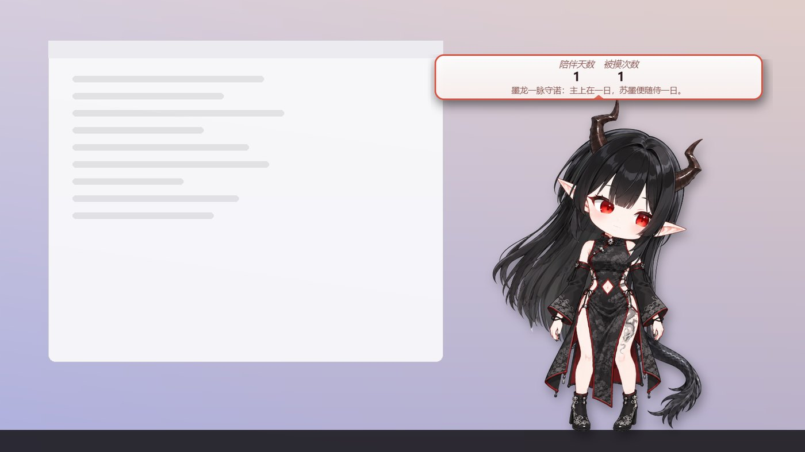
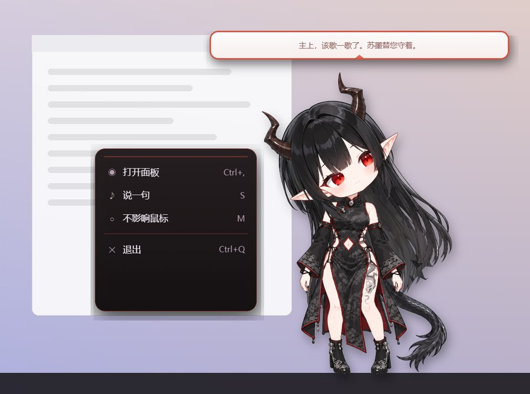

# InkPet 墨宠

Windows 上的 Live2D 桌宠。窗口透明、置顶，只有角色身上挡鼠标，透明的地方照常点得到后面的窗口。角色会眨眼、呼吸、跟着鼠标看，拖起来身体、头发和尾巴跟着甩。它还能念台词，语音有三种任选。改完 PSD 一保存，几秒后桌面上的角色就换成新生成的模型。

自带一个角色：**苏墨**（墨龙执事）。

<p align="center">
  
  
</p>

> **English summary.** **InkPet** — a Live2D desktop pet for Windows, built with Electron.
> - The window is transparent and stays on top. Only the character catches the mouse; clicks pass through everything else.
> - It can speak through Windows TTS, Alibaba Cloud Qwen TTS, or your own TTS server.
> - Other programs can control it through a small local HTTP API.
> - Whenever you save the PSD, it rebuilds the Live2D model with PSD2Live.
> - The Live2D Cubism SDK is **not** included. Download it from Live2D, accept their license, then run `npm run setup`.
> - Documentation is in Chinese. Code is MIT; the bundled character's art is CC BY-NC 4.0.

## 能做什么

- **只认角色本身**：只有角色画出来的像素算命中，透明的地方不挡鼠标。拖到屏幕边时按角色的轮廓贴边，不留空隙。
- **会动**：
  - 平时会眨眼、呼吸、左右轻晃，头和眼睛跟着鼠标转。
  - 拖动时，身体、四肢、头发、尾巴带着弹簧的惯性甩起来。
  - 点一下会点头、抖耳朵、甩尾巴，并冒一个气泡（陪伴天数、被摸次数等）。
  - 别的程序可以经本机接口让它做动作：点头、摇头、打哈欠、开心跳……
- **换装**：衣服和配件可以单独开关。苏墨能开关的是长袖、靴子、龙角、尾巴。
- **说话**：
  - 语音可以用 Windows 自带语音、阿里云千问语音合成，或者你自己的语音服务。
  - 念的时候按音量对口型。
  - 什么时候说话由你定：点它时说、空闲时偶尔说、别的程序叫它说。
- **本机接口**：脚本或插件可以经 `127.0.0.1` 让它说话、做动作、换角色。
- **改 PSD 实时换模型**：桌宠盯着角色的 PSD，一保存就用 PSD2Live 重新生成 Live2D 模型并原地换上，一般要 4～8 秒。
- **控制中心**，分五页：
  - 角色
  - 外观：3 种质感 × 5 种颜色
  - 气泡与数据
  - 语音
  - 系统：开机自启、本机接口、数据目录

## 要准备的

- Windows 10 或 11（64 位）。
- [Node.js](https://nodejs.org/) 22 或更新。
- Live2D Cubism SDK for Web：自己下载，见下面第 3 步。
- 可选，只有「从 PSD 生成模型」时才用到：Python 3.10+ 和 PSD2Live（官方免安装包自带 Java）。详见[从 PSD 生成模型](#从-psd-生成模型)。

## 快速开始

1. 下载本项目：`git clone` 或下载 zip 解压，然后在项目目录里打开 PowerShell。
2. 装依赖：

   ```powershell
   npm install
   ```

   第一次 `npm start` 时还会下载 Electron 本体（一百多 MB）。在国内这两步都很慢的话，在同一个 PowerShell 窗口里先换成镜像，后面的 `npm start` 也在这个窗口里运行：

   ```powershell
   $env:ELECTRON_MIRROR = "https://npmmirror.com/mirrors/electron/"
   npm install --registry=https://registry.npmmirror.com
   ```

3. 装 Live2D 运行库：
   1. 打开 Live2D 官网的 [Cubism SDK for Web 下载页](https://www.live2d.com/en/sdk/download/web/)，读完并同意许可协议后下载，得到 `CubismSdkForWeb-5-r.x.zip`。
   2. 运行下面的命令。如果 zip 就在「下载」目录里，直接 `npm run setup` 也能找到。

   ```powershell
   npm run setup -- "C:\Users\你\Downloads\CubismSdkForWeb-5-r.5.zip"
   ```

   这一步做的事：
   - 从 SDK 里取出 Live2D Core 和着色器，放进 `renderer/vendor/live2d/`。
   - 把我们的驱动（`live2d/driver.js`）和 SDK 里的 Cubism Framework 打包成 `pet-live2d.js`。
   - 这些文件只留在你自己的电脑上，不进仓库。
   - 本项目是照 SDK 5-r.5 写的。

4. 启动：

   ```powershell
   npm start
   ```

   桌宠出现在屏幕右下角，托盘里会多一个小爪子图标。
   - 没装好 Live2D 运行库，或者找不到角色模型时，桌宠只显示一个气泡，写着缺什么。
   - 照着气泡补上就行，补好后要重新 `npm start`。

## 怎么用

| 操作 | 效果 |
| --- | --- |
| 左键点角色 | 点头、抖耳或甩尾，冒气泡；点中头和尾巴的反应不一样 |
| 左键按住拖 | 挪位置；松手的地方会记住 |
| 右键角色 / 点托盘图标 | 菜单：打开控制中心、换角色（有好几个角色时）、说一句 / 停下、不影响鼠标、退出 |
| `Ctrl+Alt+U` | 停下正在念的话 |



- **不影响鼠标**打开后，整个桌宠都不挡鼠标，连角色本身也点不到。要关掉的话，点托盘图标打开菜单。
- 设置、陪伴天数、日志都放在用户数据目录 `%APPDATA%\inkpet\`。控制中心「系统」页能打开这个目录，里面有：
  - `config.json`：设置。
  - `stats.json`：陪伴天数、被摸次数。
  - `main.log`、`renderer.log`：日志。
  - `api-token.txt`：本机接口的令牌。
  - `characters/`：你自己加的角色档案。

## 语音

在控制中心「语音」页里选合成服务，可以选几个并排好先后。会按顺序试，第一个出声的算数。

| 服务 | 要什么 | 说明 |
| --- | --- | --- |
| Windows 自带语音 | 什么都不用装 | 音质一般。中文要系统里有中文语音，中文版 Windows 一般自带 Huihui |
| 阿里云百炼 · 千问语音合成 | 自己的 API Key | 音质好，开口快，约 0.3～1 秒；按字数计费 |
| 自定义接口 | 你自己的语音服务 | IndexTTS、GPT-SoVITS 这类，照[接口协议](docs/voice.md#自定义接口的协议)包一层就能接 |

念什么在「语音」页下半部分设：「点角色时念」、「空闲时说一句」（隔几分钟说一句）。别的程序经本机接口推来的话也会念。

详见 [docs/voice.md](docs/voice.md)。

## 本机接口

桌宠在 `127.0.0.1:18932` 上开了一个小接口，给脚本和插件用。每个请求都要带令牌，令牌可以在控制中心「系统」页复制；浏览器里的网页发来的请求一律拒绝。

```powershell
$h = @{ Authorization = "Bearer " + (Get-Content "$env:APPDATA\inkpet\api-token.txt").Trim() }
Invoke-RestMethod -Method Post -Uri http://127.0.0.1:18932/say -Headers $h -ContentType "application/json; charset=utf-8" -Body '{"text":"主上，该休息了。"}'
```

有这几个接口：`GET /state`、`POST /say`、`POST /stop`、`POST /action`、`POST /character`。详见 [docs/local-api.md](docs/local-api.md)。

## 角色模型

角色有两样东西：

- **角色档案**：`characters/<id>.json`。里面写名字、称呼、模型在哪、主题、衣服开关，还有 rig（部件名、关节、口型、点击分区）、尾巴和台词。
- **Live2D 模型**：档案里 `model` 指向的 `*.model3.json`，连同它的 moc3、贴图、物理。

苏墨的模型在 `assets/live2d/sumo/`，工作用的 PSD 在 `assets/sumo/src/sumo.psd`。PSD 里衣服底下的身体层是只画了皮肤的素体，可以拿来改衣服、做换装。

### 加自己的角色

1. 准备模型：用 PSD2Live 生成的最省事；别的工具做的 Live2D 模型也能放。
2. 写一份角色档案：
   - 放进用户数据目录的 `characters/`（`%APPDATA%\inkpet\characters\`）。
   - 档案里的相对路径按档案所在的目录算。
   - id 和自带角色一样时，你的那份优先。
3. 重新启动桌宠，在右键菜单或控制中心「角色」页选它。

档案的写法见 [docs/characters.md](docs/characters.md)。

## 从 PSD 生成模型

角色档案写了 `psd` 时，桌宠会一直盯着这个 PSD，一保存就自动重新生成模型：

1. `tools/model_build/psd_prepare.py` 整理 PSD：
   - 图层全部设成可见。
   - 蒙版、剪贴图层合进像素。
   - 单层的闭眼拆成左右两层。
   - `#` 开头的图层和组跳过。
2. PSD2Live 生成 Live2D 模型。
3. 检查产物没问题后换进模型目录。旧版本挪进 `.prev/`，桌宠原地重载新版。

生成失败时，桌宠保持上一版，控制中心「系统」页会写原因。

要装的东西：

- **Python 3.10+**，再装几个包：`pip install psd-tools numpy pillow`。
- **PSD2Live**：一个开源的 PSD → Live2D 模型生成工具（GPL-3.0），两种任选：
  - **官方版**：从 [Releases 页](https://github.com/tsunehimatoi/psd2live/releases)下载 `windows-x64-portable.zip`，解压到 `tools/psd2live/`，让 `PSD2Live.exe` 正好在这个目录下。自带 Java，不用另装。尾巴不会单独摆。
  - **我们改过的版本**：自己编出 `PSD2Live.jar`，放进 `tools/psd2live/`，要 Java 21（设了 `JAVA_HOME` 或者 `java` 在 PATH 里）。尾巴会摆。
  - 推荐用我们改过的版本，它加了尾巴物理和头发网格兜底，源码和 jar 见 [THIRD_PARTY.md](THIRD_PARTY.md#psd2live)。
  - 用上游版本也能生成，只是尾巴没有物理。

Python、Java、PSD2Live 的路径也可以在 `config.json` 的 `modelBuild` 里写死：

```json
"modelBuild": { "python": "C:\\Python312\\python.exe", "jar": "D:\\tools\\PSD2Live\\PSD2Live.exe" }
```

`pipeline/` 里是做苏墨时拆图层用的脚本：经 ComfyUI 的 See-through 插件把一张立绘拆成分层，再整理成 PSD。用法写在每个脚本的开头，这几个脚本另外要 `pip install scipy`。

## 制作教程

[docs/tutorial](docs/tutorial/README.md)：以做苏墨的真实过程为例，从一张立绘讲到桌面上会动的桌宠。

0. [开始之前](docs/tutorial/00-开始之前.md)：整条流程、要装的软件
1. [准备立绘](docs/tutorial/01-准备立绘.md)
2. [AI 拆图层](docs/tutorial/02-AI拆图层.md)：ComfyUI + See-through
3. [修图层、起名字](docs/tutorial/03-修图层.md)：补画被挡住的地方，图层命名的规则
4. [生成 Live2D 模型](docs/tutorial/04-生成模型.md)：PSD2Live，离屏预览检查
5. [放进桌宠](docs/tutorial/05-放进桌宠.md)：写角色档案
6. [边画边看](docs/tutorial/06-边画边看.md)：存 PSD 自动重新生成
7. [调手感](docs/tutorial/07-调手感.md)：眨眼、呼吸、摆动、点击和拖动的反应
8. [语音和本机接口](docs/tutorial/08-语音和本机接口.md)
9. [常见问题](docs/tutorial/09-常见问题.md)

## 目录

```
main.js                 主进程：窗口、命中、拖动、角色、语音、模型生成、托盘和菜单
preload.js              桌宠窗口的 preload
renderer/               桌宠窗口（pet.js）、控制中心（center.*）、右键菜单（menu.*）
live2d/driver.js        Live2D 驱动：在官方 Cubism Framework 上加了 rig、摆动、口型、命中
src/voice/              语音合成（Windows 自带 / 千问 / 自定义接口）
src/local-api.js        本机接口
characters/             随程序带的角色档案
assets/                 图标、角色模型和 PSD
tools/                  拖动助手（drag-helper.ps1）、PSD 整理、离屏预览
pipeline/               拆图层脚本（See-through → PSD）
scripts/                npm run setup：装 Live2D 运行库
test/                   npm test
docs/                   文档
```

开发和调试见 [docs/development.md](docs/development.md)。

## 许可

- **代码**：[MIT](LICENSE)。
- **苏墨**：这个角色的名字、设定、台词、立绘、PSD、Live2D 模型（`assets/live2d/sumo/`、`assets/sumo/`，以及 `characters/sumo.json` 里的角色内容）用 [CC BY-NC 4.0](LICENSE-ART.md)：
  - 可以转载、改编，要署名。
  - 不能用于商业目的。
- **Live2D Cubism SDK**：不在本仓库里。它是 Live2D Inc. 的软件，用的人自己下载，并同意 Live2D 的许可协议。
  - 把基于本项目做的东西拿去发布之前，请先读 Live2D 的[发布许可](https://www.live2d.com/en/sdk/license/)。
  - 能让用户自己加模型的程序，可能属于 Live2D 说的「[拓展性应用（Expandable Application）](https://www.live2d.com/en/?p=607)」。
- 其他第三方组件见 [THIRD_PARTY.md](THIRD_PARTY.md)。

本项目和 Live2D Inc. 没有关系，也没有得到它的认可。
