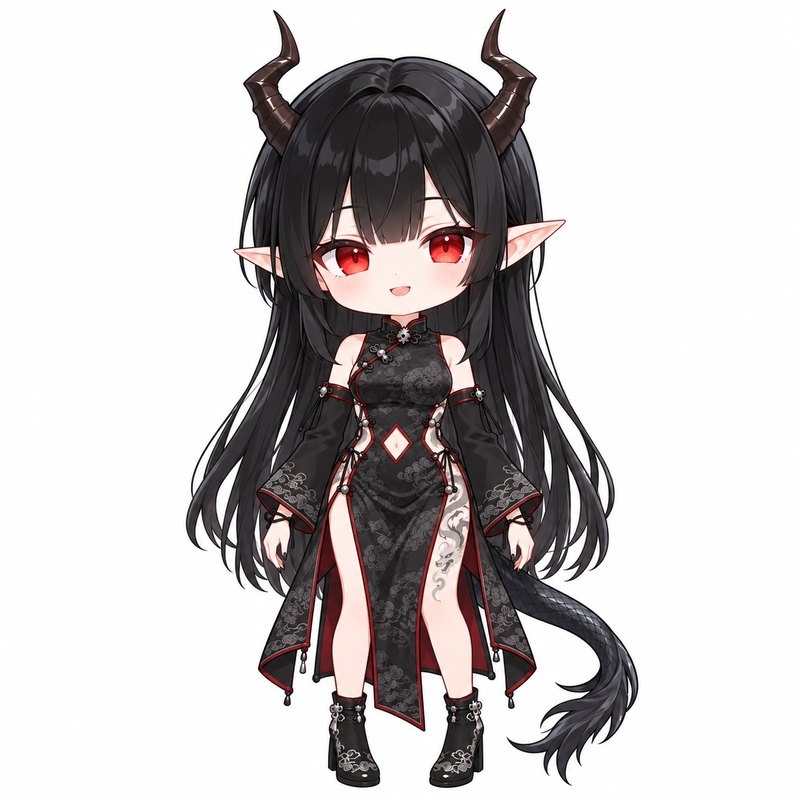

# 1. 准备立绘

立绘决定了后面每一步好不好做。拆图层的 AI 和生成模型的 PSD2Live 都喜欢「站得正、东西不互相挡」的图。

苏墨的立绘是先用 AI 按设定图生成了几张 Q 版，再挑了这一张。你也可以自己画。

## 立绘的要求

1. **正方形、白底或纯色底**，全身完整入画，四周留一点白。苏墨的是 1254 × 1254，后面补白边到 1280 × 1280。
2. **Q 版比例更好做**：头大身子小，桌宠缩到桌面大小时还看得清脸。苏墨的头大约占全身的 40%。
3. **正面站直**，身体不歪。头可以微微歪，PSD2Live 认得出歪头，不过别超过 25°。
4. **双臂自然下垂，和身体之间留一点缝**，两腿稍微分开。手里别拿东西，手也别挡住衣服。
5. **尾巴、长发这类会甩的东西，别绕到身体前面**。苏墨的尾巴从身后伸向一侧再垂下来，整条都在画面里。
6. **角、耳朵、发饰画完整**，别被画面边缘裁掉。
7. **睁眼，嘴微张**。PSD2Live 以「张到最大的嘴」为准往里收成闭嘴，所以原图的嘴要张开；闭眼第 3 章再单独画。
8. **线条清楚、平涂为主**。阴影太重、颜色对比太低（比如黑衣服配深红滚边）会让 AI 拆图层时分不清边界。花纹太细的地方，拆完会糊。

## 用 AI 生成时

- 给 AI 两张参考图效果最好：一张角色的设定图（定人物和衣服），一张你喜欢的 Q 版桌宠（定比例和画风）。
- 一次出 2～4 张，挑一张最符合上面要求的。细节（花纹、扣子数量）对不上没关系，后面能修。
- AI 生成的图在有的地区不受版权保护。想要版权最清楚，就照着 AI 的设计自己重新画一遍。

## 打算做换装的话

想以后给角色换衣服，最好再准备一张**素体**：同一个姿势、只画皮肤的版本（不画性征，像人偶一样）。苏墨就是这么做的：先在穿衣服的立绘上拆一遍，再在素体上拆一遍，把衣服图层叠到素体上。这样衣服底下不会有洞，换一套衣服就是换几层图。

下一章：[2. AI 拆图层](02-AI拆图层.md)
