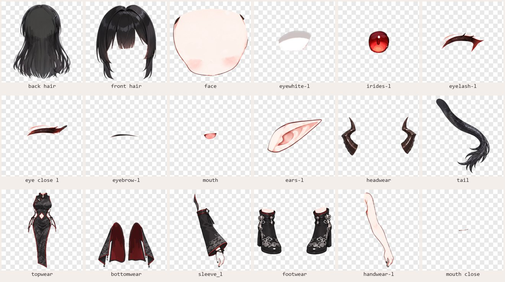

# 3. 修图层、起名字

这一章做完，你就有一份可以直接拿去生成模型的 PSD。苏墨的 PSD 在 `assets/sumo/src/sumo.psd`，可以打开对照着看。

## 用什么软件

能打开、保存带图层的 PSD 就行：Photoshop、[Krita](https://krita.org/)（免费）都可以。

不想装软件，就用网页版的 [Photopea](https://www.photopea.com/)。它免费（页面边上有广告），浏览器打开就能用，菜单和 Photoshop 差不多，有中文界面（在「更多 → 语言」里换）。官网写着文件在你自己的电脑上处理，不上传。

- 打开：把 PSD 拖进页面，或者点「从电脑打开」；
- 改图层名：在图层面板里双击名字；
- 存盘：「文件 → 存储为 PSD」，浏览器会像下载文件一样把它存到电脑上。

## 图层要起什么名字

PSD2Live 按**图层名**认部件，认出来的部件才会有对应的动作：后发会摆、眼睛会眨、嘴会开合。常用的名字：

| 图层名 | 是什么 | 生成后会怎么动 |
| --- | --- | --- |
| `back hair` | 后发（脸后面那片） | 跟头转，自带摆动物理 |
| `front hair` | 刘海、鬓角 | 跟头转，自带摆动物理 |
| `headwear` | 帽子、发饰、角 | 跟头转 |
| `face` | 脸（只画皮肤和脸型） | 头部转动的基准 |
| `eyewhite` | 眼白 | 闭眼时收成一条线 |
| `irides` | 瞳孔 | 跟着鼠标看 |
| `eyelash` | 上睫毛（只画上睫毛） | 闭眼时弯成 U 形 |
| `eye close` | 闭眼的样子 | 闭眼时渐显（可选，但效果好很多） |
| `eyebrow` | 眉毛 | 上下动 |
| `ears` | 耳朵 | 转头时远侧那只变淡 |
| `mouth` | 嘴，**画成张到最大的样子** | 往中线收拢就是闭嘴 |
| `mouth close` | 闭嘴线（可选） | 张嘴时渐隐 |
| `neck` | 脖子 | 承接头和身体 |
| `topwear` | 上衣 | 跟身体转、跟着呼吸起伏 |
| `bottomwear` | 裙子、裤子、衣服后摆 | 下半身 |
| `handwear` | 手臂、手 | 跟身体走 |
| `legwear` | 腿 | |
| `footwear` | 鞋、脚 | |
| `tail` | 尾巴 | 官方版跟着身体走；我们改过的版本会自己摆（见第 4 章） |

完整的名字表（还有牙、舌头、眼镜、耳环、翅膀等，也认中文、日文、韩文名）在 PSD2Live 的文档 [PSD 素材与命名](https://github.com/tsunehimatoi/psd2live/blob/master/docs/zh/spec/PSD_LAYER_SPEC.md) 里。

起名的规矩：

- **成对的部件分左右**：后面加 `-l` / `-r`（或者空格加 `l` / `r`），比如 `eyelash-l`、`eye close r`。**按角色自己的左右**：角色的左手在画面右边。两只眼睛画在同一层也行，PSD2Live 会自己从中间切开。
- **复制出来的「拷贝」「copy」后缀不用删**：`neck 拷贝` 也认得。
- **认不出的名字也会进模型**，只是不会有专门的动作，跟着身体走。苏墨的 `sleeve_l` / `sleeve_r`（分离式长袖）、`body`（素体躯干）就是这样。
- **最好用英文名**。中文名在有的保存方式下会变成乱码。InkPet 生成模型前会先整理一遍 PSD（第 6 章），整理时会把中文名写对。
- **名字以 `#` 开头的图层不进模型**，草稿、参考图可以这样留在 PSD 里。

## 要补画的东西

AI 拆出来的图层，下面几样一般要自己补。做苏墨时这些都是手画的。

### 1. 闭眼

画一层 `eye close`：闭上的眼睛（一条弯弯的线加睫毛）。两只画在一层就行。不画的话，闭眼就是眼睛那块变成一片皮肤，看着怪。

### 2. 被挡住的地方

模型动起来时，原来被挡住的地方会露出来，所以都要画完整：

- 脸后面的后发（转头时会露出来）；
- 手臂后面的身体、袖子里面的手臂（甩手时露出来）；
- 衣服前摆后面的腿（走动、拖动时露出来）；
- 尾巴根部、角后面的头发。

See-through 已经猜着补了一部分，但常常不太对，要看一遍、改一遍。补的时候可以先在模型里看哪儿露了洞（第 4 章的预览、第 6 章的实时生成），再回来补。

### 3. 衣服和身体分开

想做换装（衣服能开关、能换别的衣服），身体就要画完整：衣服底下画一个只有皮肤、不画性征的素体，衣服一件一层盖在上面。苏墨的做法：

1. 先拆一遍穿衣服的立绘，留下头发、衣服、靴子这些层；
2. 再拆一遍素体（第 1 章说的那张），留下身体、四肢；
3. 把两边拼在一起：素体在下，衣服在上；
4. **把衣服层里带着的原图皮肤抠干净**（比如衣服镂空、露肩的地方），不然衣服会带着一块旧皮肤盖在素体上。

苏墨现在能开关的是长袖、靴子、龙角、尾巴，旗袍固定穿着。

## 嘴

PSD2Live 只要一张**张到最大的嘴**，平时那张嘴会被收成一条缝，当作闭嘴。所以：

- `mouth` 画张开的嘴；
- 想要更好看的闭嘴，可以另画一层 `mouth close`（闭嘴线）。但两样都有时，平时会同时出现两条线，要在角色档案里选留哪一条（第 5 章的 `psdSkipLayers`）。苏墨留的是程序压出来的那条。

## 存盘

- 存成 PSD（Photoshop 格式），保留图层。Photopea 用「文件 → 存储为 PSD」。
- 画布大小和立绘一样（苏墨是 1280 × 1280）。
- 图层可以隐藏着存。InkPet 整理时会把所有图层都当作要用的，只跳过 `#` 开头的。
- 每次大改另存一份，比如 `v1`、`v2`，方便回退。

下一章：[4. 生成 Live2D 模型](04-生成模型.md)
