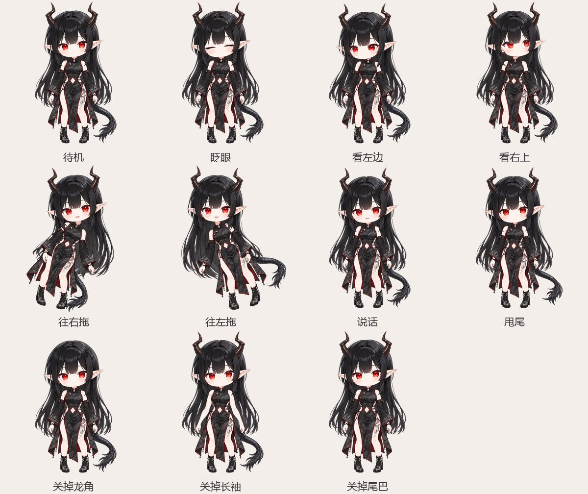

# 4. 生成 Live2D 模型

[PSD2Live](https://github.com/tsunehimatoi/psd2live) 是一个开源工具：输入分层 PSD，自动切网格、搭变形器、配物理，直接输出 Live2D 模型。整个过程不用 Cubism Editor。

> PSD2Live 是第三方按 Live2D 文件格式自己实现的工具，和 Live2D 公司没有关系，许可证是 GPL-3.0。InkPet 只是另起一个进程调用它，不把它打包进来。

## 用哪个版本

| | 官方版（推荐） | 我们改过的版本 |
| --- | --- | --- |
| 版本 | 3.x（写这篇时是 3.5.2） | 基于 0.1 |
| 怎么装 | 下载免安装包，解压就能用，**自带 Java** | 自己编，要装 Java 21 |
| 尾巴 | 挂在身体上，跟着身体走，自己不摆 | **会摆**：多出 `ParamTail`（物理）和 `ParamTailWag`（桌宠点尾巴时甩尾用） |
| 其他 | 自带完整的编辑器：骨骼、模拟、动画都能在里面调 | 头发细丝多时不会生成出拉到画布四角的细线 |
| 地址 | [Releases 页](https://github.com/tsunehimatoi/psd2live/releases) | 发布时补上（GPL-3.0，附源码） |

InkPet 两种都认。苏墨的尾巴要会摆，所以仓库里的苏墨模型是用改过的版本生成的。我们也拿官方 3.5.2 实测过苏墨：InkPet 能直接用，载入、拖动、眨眼、换装都正常，只是尾巴不摆。

## 装官方版

1. 打开 [PSD2Live 的 Releases 页](https://github.com/tsunehimatoi/psd2live/releases)，下载 `PSD2Live-<版本>-windows-x64-portable.zip`。
2. 解压到 InkPet 的 `tools\psd2live\`，让 `PSD2Live.exe` 正好在这个目录下：

   ```
   tools\psd2live\
     PSD2Live.exe
     app\
     runtime\
   ```

   这个目录不进仓库。

双击 `PSD2Live.exe` 就是它的编辑器，InkPet 是用命令行调它的。

## 编改过的版本

改过的版本要从源码编，要 Java 21。它依赖同一作者的 [umamo](https://github.com/umamoorg/umamo)，两个仓库要放在同一个目录下：

```
psd2live_ws/
  psd2live/
  umamo/
```

在 PowerShell 里：

```powershell
cd psd2live_ws
git clone <我们改过的版本的地址> psd2live
git clone https://github.com/umamoorg/umamo.git
cd psd2live
$env:JAVA_HOME = "C:\Program Files\Eclipse Adoptium\jdk-21…"   # 换成你装的 Java 21 的目录
..\umamo\gradlew.bat -p . packageUberJarForCurrentOS
```

第一次编会下载一堆依赖，要几分钟。编好的文件在 `build\compose\jars\PSD2Live-windows-x64-<版本>.jar`，把它拷成 InkPet 的 `tools\psd2live\PSD2Live.jar`。

`tools\psd2live\` 里两个都有时，InkPet 用 `PSD2Live.exe`。想用 jar，就把 exe 挪走，或者在 `config.json` 的 `modelBuild.jar` 里写明。

## 生成模型

最省事的做法：直接交给 InkPet，看[第 6 章](06-边画边看.md)。写好角色档案以后，存一下 PSD 就自动生成并换上。

想手动跑一遍、看看它报什么，分两步：

```powershell
# 1. 整理 PSD：全部图层设为可见、蒙版和剪贴图层合进像素、单层的闭眼拆成左右、# 开头的跳过
python -I -X utf8 tools\model_build\psd_prepare.py D:\art\sumo.psd D:\art\staged.psd

# 2. 生成（官方版）
tools\psd2live\PSD2Live.exe --input D:\art\staged.psd --output D:\art\model --lang zh

# 2. 生成（改过的版本）
java -Xmx4g -Dfile.encoding=UTF-8 -jar tools\psd2live\PSD2Live.jar --input D:\art\staged.psd --output D:\art\model --lang zh
```

第一步要不要都行，但 PSD2Live 有两个脾气，第一步正好对付它们：

- 它只用**可见**的图层，而画的时候闭眼这类图层常常是隐藏的；
- 它读图层名的方式和一些软件存中文名的方式对不上，中文名可能读成乱码。

要让某些图层不进模型，第一步加 `--skip '["mouth close"]'`。

第二步要 3～7 秒。输出目录里会有：

| 文件 | 是什么 |
| --- | --- |
| `<名字>.model3.json` | 模型入口，桌宠读的就是它 |
| `<名字>.moc3` | 模型本体 |
| `<名字>.4096/texture_00.png` | 贴图集 |
| `<名字>.physics3.json` | 物理（头发、果冻眼；改过的版本还有尾巴） |
| `<名字>.cdi3.json` | 参数和部件的显示名 |
| `*.motion3.json` | 自带动作：待机（6 秒循环）、眨眼、点头、摇头 |
| `<名字>.psd2live.json` | 生成记录：哪个图层认成了什么部件、对应模型里哪个画元 |
| `<名字>.cmo3` | Cubism Editor 工程，想进编辑器细调时用（桌宠用不到） |

官方 3.x 还会多出一个 `<名字>.can3`，桌宠也用不到。

PSD2Live 生成完会自己做几道几何检查（中立姿态是否还原、极限姿态有没有撕裂、左右是否对称），没通过会在输出里说。「未知图层」「同名图层」这类提示只是提醒，不是出错。

`<名字>.psd2live.json` 的 `layers` 里能查到每个图层对应的画元名，比如 `back hair` → `ArtMeshBackHair`、`sleeve_l` → `ArtMeshLayerL`。下一章写角色档案时要用这些名字。

## 看看效果

官方版双击 `PSD2Live.exe` 打开的编辑器，能拖着看各个参数。InkPet 也带了一个离屏预览工具：用和桌宠完全一样的渲染方式，按一串步骤摆姿势、截图。这样不用反复重启桌宠：

```powershell
npx electron --user-data-dir="$env:TEMP\inkpet-preview" tools/preview/preview_main.cjs characters/sumo.json scenario.json out
```

`scenario.json` 是一串步骤，例子：

```json
[
  { "frames": 90, "shot": "idle" },
  { "eye": 0, "frames": 6, "shot": "blink" },
  { "pointer": [-0.9, 0.3], "frames": 40, "shot": "look_left" },
  { "motion": [0, 0, 1.2, 0.8], "frames": 45, "shot": "drag_right" },
  { "mouth": "open", "mouthOpen": 0.7, "frames": 20, "shot": "talk" },
  { "extra": { "ParamTailWag": 0.9 }, "frames": 20, "shot": "wag" },
  { "cloth": { "horns": false }, "frames": 20, "shot": "horns_off" }
]
```

每一步能给的字段：

| 字段 | 说明 |
| --- | --- |
| `motion` | `[身体, 侧倾, 拖动摆幅, 拖动速度]`，和桌宠拖动时给的一样 |
| `pointer` | `[x, y]`：鼠标在哪个方向，-1～1 |
| `eye` | 眼睛开合：0 是闭眼，1 是睁眼 |
| `mouth` | 口型：`smile`、`open`、`triangle` |
| `mouthOpen` | 开合程度 |
| `cloth` | 衣服开关 |
| `extra` | 额外的参数，比如尾巴 |
| `ear` | `true` 表示抖一下耳朵 |
| `frames` | 跑几帧 |
| `shot` | 截一张图，存到输出目录的 `<名字>.png` |
| `hit` | 给几个坐标，看各点中了哪个部件 |

苏墨的各种姿势就是这么截出来的：



重点检查这些地方：

- 转头、拖动到最大时，哪里露出了透明的洞（回第 3 章补）；
- 闭眼、张嘴好不好看；
- 头发、尾巴的切口有没有直线；
- 手臂、袖子甩得是不是太夸张（第 7 章能调）。

下一章：[5. 放进桌宠](05-放进桌宠.md)
