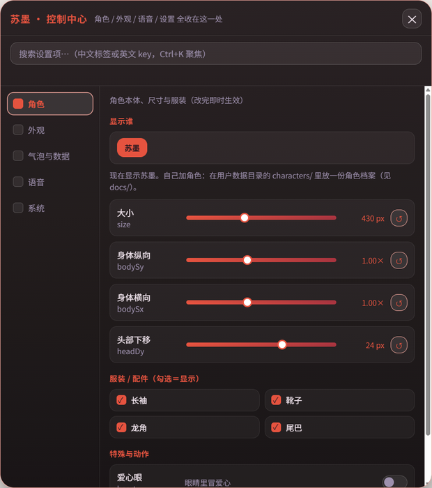

# 5. 放进桌宠

模型有了，再写一份**角色档案**，桌宠就认得它了。档案是一个 JSON 文件，写名字、怎么称呼你、模型在哪、衣服开关、台词、哪些部件怎么动。字段的完整说明在 [docs/characters.md](../characters.md)，这一章按顺序走一遍。

## 放在哪

自己加的角色放在用户数据目录（控制中心「系统」页最下面有「打开数据目录」）：

```
%APPDATA%\inkpet\characters\
  mychar.json             角色档案
  mychar\                 模型（第 4 章的输出目录整个拷进来）
    mychar.model3.json
    mychar.moc3
    …
```

档案里的相对路径按档案所在的目录算。

## 第一步：最小的档案

```json
{
  "id": "mychar",
  "name": "小明",
  "callUser": "主人",
  "model": "mychar/mychar.model3.json"
}
```

重新启动桌宠，在右键菜单或控制中心「角色」页选它。能看到、会眨眼、会跟着鼠标看，第一步就成了。

这时候用的是默认设置：按 PSD2Live 的画元名驱动，手臂、腿的关节位置是另一个角色的，拖动时可能甩得不对。下面一样一样补。

## 第二步：称呼、主题、台词

```json
{
  "id": "mychar",
  "name": "小明",
  "title": "见习魔法师",
  "callUser": "师父",
  "order": 1,
  "model": "mychar/mychar.model3.json",
  "theme": { "style": "glass", "color": "midnight" },
  "custom": "小明在练习新咒语",
  "lines": {
    "stats": ["师父，今天也要加油哦。", "这个咒语我已经会了一半了！"],
    "say": ["师父，该休息一下啦。"]
  }
}
```

- `stats`：点角色时，气泡里随机挑一句显示。
- `say`：要念出来时用，比如点角色时念、空闲时念、右键菜单「说一句」。不写就用 `stats`。

## 第三步：衣服开关

先打开第 4 章生成的 `<名字>.psd2live.json`，在 `layers` 里查每个图层对应的画元名。然后在档案里把开关名和画元名对上：

```json
"cloth": {
  "keys": ["sleeves", "horns"],
  "labels": { "sleeves": "长袖", "horns": "龙角" }
},
"rig": {
  "cloth": {
    "sleeves": ["ArtMeshLayerL", "ArtMeshLayerR"],
    "horns": ["ArtMeshHeadwear"]
  }
}
```

控制中心「角色」页会多出这几个勾选框：



只做「关掉不会露出不该露的东西」的开关，比如配件、外套。

穿着某件东西时要顺带藏起别的部件，用 `autoCloth`。苏墨穿着靴子时把脚藏起来：

```json
"autoCloth": [ { "when": "boots", "hide": ["ArtMeshLegwear"] } ]
```

## 第四步：关节（让拖动时甩得对）

拖动桌宠时，手臂、腿、衣摆是按「骨轴」甩的。每一条写清楚根在哪、梢在哪，坐标是模型画布上的像素：

```json
"limbs": [
  { "key": "armL", "draws": ["ArtMeshHandwearL", "ArtMeshLayerL"], "root": [722, 560], "tip": [845, 900], "gain": 0.42, "K": 300, "C": 14, "u0": 0.2 },
  { "key": "legs", "draws": ["ArtMeshLegwear2", "ArtMeshLegwear", "ArtMeshFootwear"], "root": [640, 790], "tip": [640, 1245], "gain": 0.35, "K": 250, "C": 15 }
]
```

- `root` 是肩膀 / 胯，`tip` 是手 / 脚；
- `gain` 越大甩得越开；
- `K` 越大回弹越快，`C` 越大停得越快。

怎么量坐标：

- 在 PSD 里看：画布就是模型的坐标系，左上角是 (0, 0)，Photoshop 的信息面板直接显示鼠标坐标。
- 或者用第 4 章的预览工具：给 `hit` 几个点，看各点中了哪个部件。

改完重启桌宠看效果；不对就改数，再看。苏墨的完整档案在 [characters/sumo.json](../../characters/sumo.json)，有四条肢体、两只会抖的耳朵、甩尾、只有一张嘴的口型，可以照着改。

## 第五步：点哪里有什么反应

```json
"hit": {
  "head": ["ArtMeshFace", "ArtMeshFrontHair", "ArtMeshEarsL", "ArtMeshEarsR"],
  "tail": ["ArtMeshTail"]
}
```

点到 `head` 里的部件：点头、抖耳朵。点到 `tail` 里的部件：甩尾巴。点到别的地方：轻轻一缩。

## 第六步：尾巴、耳朵（有的话）

用改过的 PSD2Live 生成、带 `tail` 图层的模型，会有 `ParamTailWag` 这个参数（官方版生成的没有，尾巴就只跟着身体走，下面这段写了也不会出错）：

```json
"tail": { "param": "ParamTailWag", "idleAmp": 0.18, "idlePeriod": 4.2, "burstAmp": 0.9, "burstFreq": 2.2, "burstDecay": 1.5, "dragGain": 1.0, "sayAmp": 0.45 },
"rig": { "extraParams": ["ParamTailWag"] }
```

尾巴的效果：

- 平时慢慢摆；
- 点到尾巴时甩一阵；
- 拖动时往反方向拖着；
- 开口说话前轻甩一下。

会抖的耳朵写在 `rig.ears`，格式和 limbs 差不多，见 [characters.md](../characters.md#rig)。

## 第七步：写上 PSD

```json
"psd": "src/mychar.psd",
"psdSkipLayers": ["mouth close"]
```

写了 `psd`，下一章的「边画边看」就开了：桌宠会盯着这个 PSD，一保存就重新生成模型。`psdSkipLayers` 里的图层不进模型。

下一章：[6. 边画边看](06-边画边看.md)
