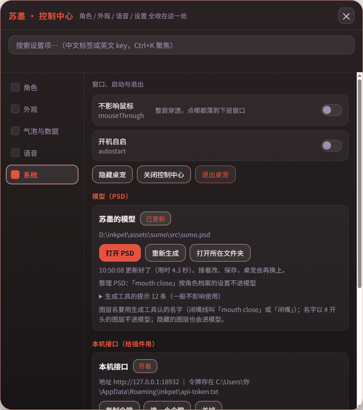

# 6. 边画边看

角色档案写了 `psd` 以后，桌宠会一直盯着这个 PSD：你在 Photoshop 或 Krita 里**一保存**，它就在后台重新生成模型，几秒后桌面上的角色原地换成新的。改脖子、补洞、换衣服，都不用再手动跑命令。



## 要准备的

和第 4 章一样：

- Python，装好 `psd-tools numpy pillow`；
- PSD2Live：官方免安装包解压到 `tools\psd2live\`（`PSD2Live.exe`），或者改过的版本 `tools\psd2live\PSD2Live.jar` 加 Java 21。

- `python` 在 PATH 里就行；用 jar 时，`java` 在 PATH 里或者设了 `JAVA_HOME`。
- 也可以在用户数据目录的 `config.json` 里写死路径：

```json
"modelBuild": { "python": "C:\\Python312\\python.exe", "jar": "D:\\tools\\PSD2Live\\PSD2Live.exe" }
```

`jar` 写 `PSD2Live.exe` 的路径就直接运行它；写 `.jar` 的路径就用 Java 跑，这时还可以加 `"java": "…\\bin\\java.exe"`。

缺了哪样，「系统」页的模型卡片上会写出来。只用现成模型、不改 PSD 的话，这些都不用装。

## 怎么用

1. 打开控制中心 →「系统」→「模型（PSD）」，点「打开 PSD」，用系统默认的程序打开当前角色的 PSD。
2. 改，然后保存。
3. 等几秒：卡片上会显示「等 PSD 存完 → 整理 PSD → 生成模型 → 换上新模型」，然后是「更新好了（用时 x 秒）」。苏墨一次大约 4～8 秒。

## 它做了什么

1. 等文件不再变化（大小和修改时间稳定 1.2 秒），免得读到写了一半的文件；
2. 用 `tools/model_build/psd_prepare.py` 整理 PSD：
   - 全部图层设成可见，`#` 开头的、`psdSkipLayers` 里的不要；
   - 蒙版、剪贴图层合进像素；
   - 单层的闭眼拆成左右；
   - 每层裁到有内容的范围；
3. 调 PSD2Live 生成到临时目录；
4. 检查产物：model3.json 读得出来，里面提到的 moc3、贴图、物理文件都在；
5. 旧模型挪进模型目录下的 `.prev\`，新模型换进来，桌宠原地重新载入。

哪一步失败了，桌宠都保持上一版，卡片上写原因。

## 几个小规矩

- **隐藏的图层也会进模型。** 画的时候常常只开着正在画的那层，所以不能按「隐藏 = 不要」算。不想要的图层，名字前面加 `#`。
- 改了角色档案里的 `psdSkipLayers`，重启桌宠时会自动重新生成一次，不用手动点。
- 想手动重来一次，点「重新生成」。
- 刚下载、没装生成工具时，桌宠直接用仓库里现成的模型，不会报错。

下一章：[7. 调手感](07-调手感.md)
