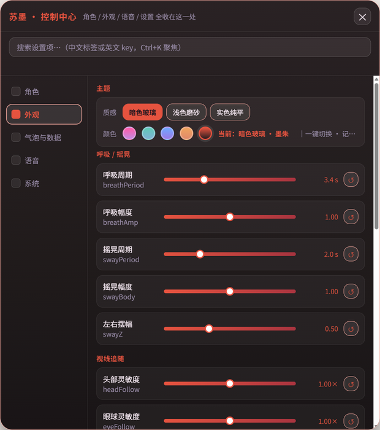
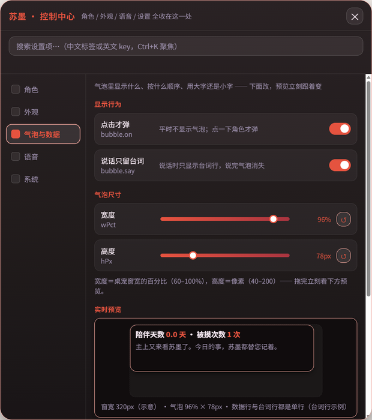

# 7. 调手感

同一个模型，摇得快一点还是慢一点，看着就是两个性格。InkPet 把这些都做成了控制中心里的滑条，拖一下马上生效，每个角色各存一份。



## 能调的

| 分组 | 滑条 | 说明 |
| --- | --- | --- |
| 角色页 | 大小 | 桌宠窗口有多大 |
| | 身体横向 / 身体纵向 | 只拉伸身体，不拉伸头；Q 版想更矮胖或更修长时用 |
| | 头部下移 | 头往下挪一点，脖子看起来就短一点 |
| 外观页 · 呼吸 / 摇晃 | 呼吸周期、呼吸幅度 | 一次呼吸几秒、起伏多大 |
| | 摇晃周期、摇晃幅度、左右摆幅 | 平时那种轻轻左右晃 |
| 外观页 · 视线追随 | 头部灵敏度、眼球灵敏度 | 跟着鼠标转得多不多；设成 0 就不跟 |
| 外观页 · 拖动 | 拖拽头跟随 | 拖动时头跟着身体倒多少：0 是头稳住，1 是一起倒 |
| | 拖拽身体摆幅 | 拖动时身体摆多大 |
| | 手臂摆幅 | 手臂、袖子甩多大 |
| 外观页 · 眨眼 | 最短间隔 / 最长间隔 | 多久眨一次，在这两个数之间随机 |
| | 连眨概率 | 有多大机会连眨两下 |
| 外观页 · 其他 | 点击音量 | 点一下的「啵」声，0 是静音 |

每条滑条右边的 ↺ 恢复默认。

## 把调好的数写进角色档案

在控制中心调的值只存在你自己的设置里。想让别人下载这个角色时默认就是这个手感，就写进角色档案的 `tune`：

```json
"tune": { "swayPeriod": 4.2, "swayBody": 0.6, "headFollow": 0.8, "limbArm": 0.6 }
```

只写想改的几项就行。所有项和范围见 [docs/characters.md](../characters.md#tune)。

## 点击和拖动

- **点击**：点到头上点头、抖耳朵，点到尾巴上甩尾巴，点到别处轻轻一缩，同时冒气泡。点到哪算哪，看档案的 `rig.hit`（第 5 章）。
- **拖动**：按住角色就能拖。只有角色画出来的像素才算「角色身上」，透明的地方点得穿。拖到屏幕边时按角色的轮廓贴边。
- **按住眯眼**：按住时眼睛眯起来，松手睁开。

点一下冒出的气泡里显示什么（陪伴天数、被摸次数、语音状态、一句自定义的话）、气泡多宽多高，在「气泡与数据」页调：



## 外观主题

气泡、菜单、控制中心有 3 种质感 × 5 种颜色。角色档案的 `theme` 是默认值，用的人在控制中心改了就以他改的为准。苏墨默认是「暗色玻璃 · 墨朱」。

下一章：[8. 语音和本机接口](08-语音和本机接口.md)
