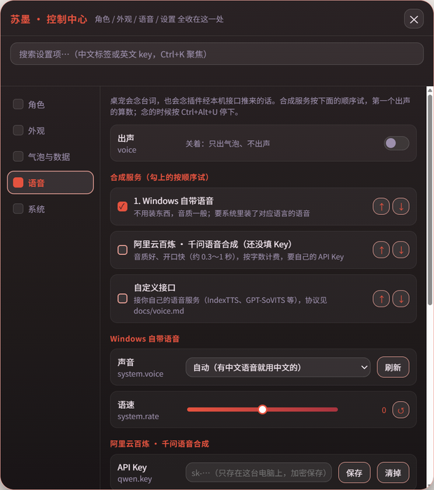
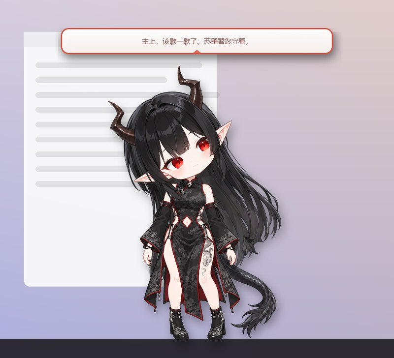

# 8. 语音和本机接口

## 让它开口

控制中心「语音」页：打开总开关，选一个或几个合成服务，排好先后，点「试听一句」。



| 服务 | 要什么 | 适合 |
| --- | --- | --- |
| Windows 自带语音 | 什么都不用装 | 先试试；音质一般 |
| 阿里云百炼 · 千问语音合成 | 自己的 API Key | 音质好、开口快，按字数计费 |
| 自定义接口 | 你自己的语音服务 | 想用 IndexTTS、GPT-SoVITS 这类给角色配专属声音 |

念的时候嘴会按音量开合。什么时候念：

- 「点角色时念」：点一下就念一句档案里的台词；
- 「空闲时说一句」：没人碰它时，隔几分钟说一句；
- 右键菜单「说一句」；
- 别的程序经本机接口推过来的话。

自定义接口的协议很简单：POST 一段文字进去，一行一行回 PCM 音频。协议和一个能直接跑的例子在 [docs/voice.md](../voice.md)。

给角色配自己的声音时注意：**拿真人的声音（包括配音演员的声音）做克隆，要本人同意**。用文字描述生成一个新声音（不少云服务有「声音设计」功能）最省心。

## 让别的程序指挥它

桌宠在本机开了一个小接口（`127.0.0.1:18932`）。脚本、插件可以让它说话、做动作、换角色：



```powershell
$h = @{ Authorization = "Bearer " + (Get-Content "$env:APPDATA\inkpet\api-token.txt").Trim() }
Invoke-RestMethod -Method Post -Uri http://127.0.0.1:18932/say -Headers $h -ContentType "application/json; charset=utf-8" -Body '{"text":"主上，该歇一歇了。苏墨替您守着。"}'
Invoke-RestMethod -Method Post -Uri http://127.0.0.1:18932/action -Headers $h -ContentType "application/json" -Body '{"id":"happy"}'
```

能用来做的事，比如：

- 编译跑完了让它报一声；
- 番茄钟到点了让它提醒；
- 接到你自己的聊天机器人上。

接口有这些规矩：

- 要带令牌，令牌在「系统」页可以复制，也可以换一个；
- 只听本机；
- 浏览器里的网页发来的请求一律拒绝。

完整说明在 [docs/local-api.md](../local-api.md)。

下一章：[9. 常见问题](09-常见问题.md)
